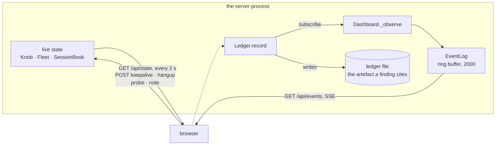

# The operator view

Off by default. `server/server.py --dashboard 8787`, or
`DASHBOARD=8787 ./server/start-server.sh`, and then
`http://127.0.0.1:8787`.

```
ssh -N -L 8787:127.0.0.1:8787 you@the-measurement-host
```

## Three things to know before turning it on

**It is out of band.** A listening HTTP port is a trait this family does not
have. A scan of the measurement host taken with the dashboard up reports a
property of this tool, not of the thing being emulated. So it binds loopback
only, it is off unless asked for, and the way to reach it is the SSH forward
above. It never touches the command port or a relay port.

**It observes the ledger, it does not replace it.** Every number on the page
is derived from events that went to the ledger file as well. The file stays
the artefact a finding cites; the page is the thing that tells you where to
look. Nothing is computed from data the file does not have.

**It computes what a periodicity detection computes.** The cadence panel is
the mean, standard deviation and coefficient of variation over the gaps
between command connections from one host — roughly the arithmetic a
beaconing detection runs. That makes it a cheap preview of whether the run it
is watching is detectable at all, before anyone goes looking in the SIEM.

## How it gets its data



The browser gets history on load and a live stream after that, so both come
from one place. A tab that stops reading has its backlog dropped rather than
allowed to back up into the thread holding a client's socket — an observer is
never worth the run.

## What is on the page

| Panel | What it answers |
|---|---|
| **Cadence** | the coefficient of variation, display-sized: near zero is a machine on a timer, and anything else is not a cadence. Under it, the shape the knob predicts and the shape the gaps measured |
| **Ticker** | command connections, mean gap and its standard deviation, implants connected, relays carrying, keep-alives sent, uptime |
| **Timeline** | one lane per implant host: command connections as bars, keep-alives as amber ticks, relay sessions as bands, deaths as red marks |
| **Ledger · live** | every event, the moment the file gets it |
| **Reconstructed proxy log** | the same run as a forward proxy would have written it — the only part of this page a detection can see |
| **Fleet** | which implants have a command connection open, for how long, and how many keep-alives and sessions each has carried |
| **Sessions** | which relays are carrying traffic right now, to what target, over which five-digit port |
| **Wire tap** | the bytes of the last handshake, with the deviation from RFC 1928 named at each step |
| **Fingerprint** | what a scanner pointed at this host would get back, beside what the real infrastructure returned |
| **Phase** | the named stretch of the run in progress, and what was detected in each one so far |
| **Ingest** | detections from anywhere else, on the same axis as the truth |

The ledger and the proxy log sit side by side, and that is the point of the
whole repository: the left pane holds everything that happened and the right
pane holds everything a detection gets. Nothing in it is invented — the
server does not know what hostname the implant dialled or how many bytes a
proxy counted, so those stay `?` rather than being guessed at.

### The scan, which is the dialect's native operation

The protocol supports `CONNECT` and nothing else, so a TCP connect sweep is
the one thing it does without being bent — and it is what an operator does
with a reverse SOCKS tunnel first: find out what the host can reach. It is
also the bursty, high-volume shape the measurement documentation describes
and that nothing here could produce deliberately before.

```
curl -s http://127.0.0.1:8787/api/scan -d '{"targets":"10.0.0.0/28","ports":"445,3389"}'
```

Every attempt goes through the server's own operator port, so it crosses the
real translation and opens a real relay session on a real ephemeral port. A
scan therefore appears on the timeline the way a scan should: a spread of
five-digit ports in a short window, with the volume to match.

Bounded on four axes, because an unbounded scanner behind a loopback port is
a different and much worse tool:

| Bound | Why |
|---|---|
| every host passes the lab guard, and one failure refuses the **whole** scan | refusing per-target would leave an operator thinking a sweep had covered a range it skipped most of |
| 2048 attempts, counted before the list is built | a cap that first allocates what it is capping spends seconds and hundreds of megabytes on a request it was always going to refuse |
| eight attempts at once | the relay broker opens one listener per pending session |
| three seconds per attempt, shorter than a probe's ten | a probe is one deliberate question and can afford to wait; a sweep spends this on every dark address |

Results come back as a tally — `open`, `refused`, `no-answer` — with the open
ports listed individually. A `/28` sweep is mostly silence, and four hundred
identical "no answer" rows would bury the three that matter.

### The read-only view

`--dashboard-view PORT` serves a second dashboard that cannot change the run:
the knob, hang-up, probe, phase and scan routes all answer `403`. It exists
so both teams can watch the same ground truth during a joint exercise with
one hand on the controls.

**`/api/ingest` stays open on it**, and that is the point rather than an
oversight: without it the read-only view would be a screen to look at instead
of a way for the other team to put its findings on the same axis. Both
dashboards share one set of marks, so a detection posted to either shows up
on both.

### The relay sessions, and what crossed them

The README calls the relays "the part that carries volume", and for a long
time the only visible fact about them was that they existed. Each live
session now reports bytes in each direction, a rate, a sparkline of the last
minute, and **what the first bytes suggest the protocol was** — an HTTP
request line with its `Host`, a TLS `ClientHello` with its SNI, an SMB
negotiate, an SSH banner. The blue team's question about a tunnel is "what
did they touch", and that is answerable from a request line.

The per-second volume also goes under each lane of the timeline, log-scaled
so that a 4 KiB probe and a 40 MiB transfer fit on one axis. The closing
`session-close` ledger line carries the byte counts and the protocol
summary, because those are the facts a volume-based detection would have had.

**The payload itself is never kept.** The sniff buffer is 512 bytes per
direction and is discarded as soon as the summary is made; none of it reaches
the ledger, the debrief or the browser. That traffic belongs to the network
under test.

One limit worth stating plainly: the server only sees the **tunnel leg**. The
implant-to-target leg is on the victim side and is invisible from here, so
everything above is the operator's view of the same stream rather than a
capture of the target's connection.

### Phases, ingest, and the number a purple exercise is for

A measurement is two or three deliberate stretches — "held connection", then
"cadence", then "traffic through it". **Name them.** Without boundaries an
alert's timestamp has nothing to be measured against: a report says "the rule
fired at 14:12" and nobody can say what was running at 14:12. Each boundary
is a ledger line, so the phases survive in the artefact a finding cites
rather than only in a browser tab.

`POST /api/ingest` then takes detections from anywhere:

```
curl -s http://127.0.0.1:8787/api/ingest -d '{
  "source": "splunk",
  "label": "Beaconing - periodic outbound CONNECT",
  "severity": "high",
  "at": 1794412345 }'
```

They appear as their own lane on the ground-truth timeline, and the offset
from the phase start is the **time to detect** — measured rather than
estimated. `at` is optional and should be the alert's own timestamp, not the
moment the webhook arrived.

This is deliberately one generic endpoint rather than an integration per
tool, and it is the extension point: a SIEM webhook, an EDR, a Zeek notice or
a colleague's annotation all land the same way, and new things need no code
here, only something that can POST. A running phase keeps an **open** window,
so a platform whose clock runs a few seconds ahead does not have its alerts
silently dropped out of the phase they belong to.

### The debrief

`GET /api/debrief` returns a markdown file: the run's settings, the cadence
per host, every phase with its detections and its time-to-detect, what a
proxy log would have held, and the last handshake byte for byte. It is
assembled only from what the ledger already holds, so it is not a second
version of the truth.

Two things it does that a list of timestamps would not:

- **A silent phase gets the right sentence, and the two are opposites.** At a
  keep-alive of `0` the client reconnects on a timer with near-zero jitter,
  so nothing firing is a finding about the **detection**. Below the client's
  timeout there is one held connection and no cadence to bin, so nothing
  firing is a finding about the **tunnel**. One sentence for both would be
  the most misleading line in the file.
- **It reports the knob being turned inside a phase.** The phase records the
  value at its start, and the knob exists to be turned mid-run, so a debrief
  with only the opening value would describe a phase that never existed. When
  the knob crossed between the two shapes inside one phase, a silence cannot
  be attributed to either and the file says so.

### The wire tap, and why it is here

This repository's claim is the wire. Until the tap existed that claim lived
in [a table](protocol.md) and nowhere in the running program, so it had to be
taken on trust. The panel shows the bytes that actually went out — the
announced relay port as a bare little-endian `uint16`, the greeting without
its version byte, `addrlen` sent for an IPv4 address that ignores it, the
port in the wrong byte order, `01` for success — each with its deviation
spelled out beside it.

**Handshakes only.** The relayed payload is never captured: it is the victim
network's own traffic, it is unbounded, and none of it is needed to show the
dialect is right.

### The fingerprint panel, and the thing it found

It connects to this server's own command port the way a researcher's scanner
did, and reports what came back. Three things worth knowing:

**It answers a question the documentation cannot** — is *this* host
fingerprintable the way the real ones were? The answer turned out to depend
on the measurement knob, which nobody had written down: the `00 00` is the
keep-alive leaking, so `--keepalive 0` is silent to a banner hunt while being
the only position with a cadence. [The measurement](measurement.md) has the
table.

**It is refused while an implant is connected**, unless forced. A bare probe
is indistinguishable from an implant, because the protocol has no identifier
— so the probe briefly joins the fleet, and `Fleet.pick` could hand it an
operator's session. That is precisely the hijack the dialect allows, and the
refusal is there so a probe does not demonstrate it on your own run by
accident.

**One row of the trait table is amber:** this dashboard is the single trait
the real infrastructure does not have. A scan of the measurement host taken
with it up reports the tool.

### The cadence panel says two things, not one

The predicted shape comes from the knob. The measured one comes from the
gaps. They do come apart, and the page says so when they do: **a relay
session resets the command connection's read deadline**, because reading the
announced port is a successful read. So a run with traffic in it has looser
cadence than the setting alone would suggest. A dashboard that only showed
the prediction would hide exactly the thing worth knowing.

## What it can change

Each of these changes the run being measured, so each is in the ledger with
`by=dashboard`.

- **The keep-alive knob**, live. The step from "one held connection" to "a
  reconnect every ~120 s" is the experiment, and turning it mid-run puts both
  shapes in one timeline with one client and one ledger.
- **Hang up on a client.** The original does not reconnect from a close, so
  this ends that implant until something outside starts it again. It is here
  so that asymmetry can be demonstrated rather than described — and it is
  what `client/supervise.py` exists to survive.
- **A probe through the tunnel**, which speaks RFC 1928 to the server's own
  operator port exactly as `curl --socks5` would. A probe that works proves
  the whole path rather than half of it. Capped at 1 KiB out and 4 KiB back:
  it is a check, not a transfer tool.
- **A note in the ledger**, which is the marker an analyst wants at the
  moment a detection fires — a dated line in the same file as the ground
  truth.

## The design, and why it looks like this

No framework, no build step, no CDN. The repository promises "Python 3,
standard library only, no install step" and a dashboard is not a good enough
reason to break that promise, so it is one HTML file, one stylesheet and one
script served by `http.server`. The `Content-Security-Policy` is
`default-src 'self'` — a dashboard for a lab tool should not be able to phone
anywhere.

**The fonts are in the repository**, in `server/web/fonts/`: Orbitron for
titles and JetBrains Mono for everything else, latin subsets, 43 KB together,
both under the SIL Open Font License. Fetching them from a font CDN would
have broken the CSP, broken the no-install promise, and failed silently on a
measurement host with no internet — which is most of them.

Two themes, switched with the button in the corner and remembered:

- **`grid`** (the default) — dark, grid-backed, neon-accented, with the
  measured coefficient of variation as a display-sized number. For a second
  monitor during a run.
- **`report`** — the same layout with the chrome taken off: no bloom, no
  scanlines, no notched corners, print-safe colours, controls hidden when
  printed. For the screenshot that goes in the finding, where a glow around a
  number is noise.

The second theme is a palette swap and one `--bloom` variable rather than a
second stylesheet, so the two cannot drift apart.

### The colours mean five things

Every colour on the page is one of these, and nothing else is coloured:

| Colour | Means |
|---|---|
| cyan | the command channel |
| magenta | the relay sessions it carries |
| acid | the measurement's own numbers |
| amber | a keep-alive |
| red | a death |

A panel says which of the five it belongs to with a short accent bar in its
top-left corner, which costs no words.

### Four choices worth naming

Each follows from the domain rather than from taste.

**The knob is a two-position switch, not a slider.** Its effect is a step,
not a slope: anything from 1 to 119 seconds produces one held connection, and
anything above 120 or exactly 0 produces the same ~120-second cadence. A
slider would promise a range of outcomes that does not exist. The number box
beside it takes the values in between and lights up when one is set, so the
page is never silent about what is actually running.

**The big number is not in the display face.** Orbitron slashes its zero, so
`0.020` reads as `Ø.Ø2Ø`. A headline can afford that character; a measured
value that gets quoted in a finding cannot. Orbitron carries the titles, the
mono carries every digit.

**The timeline defaults to `fit`.** A six-second test cadence and an
overnight held connection want windows three orders of magnitude apart, and a
fixed default puts one of them in the last pixel column. The useful span is a
property of the run, so it is read from the run.

**A gap is labelled only where it is worth reading.** The number between two
command connections is what a periodicity detection is looking for — but a
steady run wrote the same number thirty-three times, which hid it. The rule
took two tries: "label where the number changes" keeps a flat run to one
label, which is right, but under client-side jitter every gap differs from
the last and it degenerated into labelling all of them. What is worth reading
on a jittered run is the outlier, not each gap; the spread itself is already
the CV in the strip. So the first gap is labelled, then only the ones more
than a quarter away from the running mean.

## The routes

| Route | Does |
|---|---|
| `GET /api/state` | the knob, the fleet, open sessions, cadence per host, recent events |
| `GET /api/events` | server-sent events, one per ledger line |
| `POST /api/keepalive` | `{"seconds": 0}` — turn the knob |
| `POST /api/hangup` | `{"client": 3}` — close one command connection |
| `POST /api/probe` | `{"host": "10.0.0.5", "port": 80, "payload": ""}` |
| `POST /api/note` | `{"text": "SIEM alert 4411 fired"}` |
| `GET /api/wire` | the last eight captured handshakes, annotated |
| `POST /api/fingerprint` | `{"force": false}` — probe our own command port |
| `POST /api/phase` | `{"name": "phase 2 - cadence"}`, or `{"stop": true}` |
| `POST /api/ingest` | `{"source", "label", "severity", "at"}` — any detection, any tool |
| `POST /api/scan` | `{"targets": "10.0.0.0/28", "ports": "445,3389"}` |
| `GET /api/scan` | progress and findings of the sweep in flight |
| `GET /api/debrief` | the run as one markdown file |

On a `--dashboard-view` port every `POST` except `/api/ingest` answers `403`.

They are plain JSON over loopback with no authentication, which is the same
decision the operator SOCKS port already made: loopback keeps other hosts
out and does nothing about other local users on the same box. If that is not
good enough for your lab, do not pass `--dashboard`.
