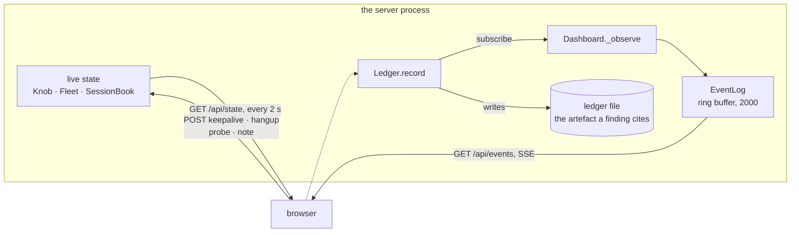

# The operator view

Off by default. `server/server.py --dashboard 8787`, or
`DASHBOARD=8787 ./server/start-server.sh`, and then
`http://127.0.0.1:8787`.

```
ssh -N -L 8787:127.0.0.1:8787 you@the-measurement-host
```

## Three things to know before turning it on

**It is out of band.** A listening HTTP port is a trait this family does not
have. A scan of the measurement host taken with the dashboard up reports a
property of this tool, not of the thing being emulated. So it binds loopback
only, it is off unless asked for, and the way to reach it is the SSH forward
above. It never touches the command port or a relay port.

**It observes the ledger, it does not replace it.** Every number on the page
is derived from events that went to the ledger file as well. The file stays
the artefact a finding cites; the page is the thing that tells you where to
look. Nothing is computed from data the file does not have.

**It computes what a periodicity detection computes.** The cadence panel is
the mean, standard deviation and coefficient of variation over the gaps
between command connections from one host — roughly the arithmetic a
beaconing detection runs. That makes it a cheap preview of whether the run it
is watching is detectable at all, before anyone goes looking in the SIEM.

## How it gets its data



The browser gets history on load and a live stream after that, so both come
from one place. A tab that stops reading has its backlog dropped rather than
allowed to back up into the thread holding a client's socket — an observer is
never worth the run.

## What is on the page

| Panel | What it answers |
|---|---|
| **Verdict** | what a proxy log will show at the current setting, and what it *actually* showed |
| **Timeline** | one lane per implant host: command connections as bars, keep-alives as ticks, relay sessions as blocks, deaths as red marks |
| **Fleet** | which implants have a command connection open, for how long, and how many keep-alives and sessions each has carried |
| **Sessions** | which relays are carrying traffic right now, to what target, over which five-digit port |
| **Events** | the ledger, live |
| **What a proxy log shows** | the same run reconstructed as a forward proxy would have written it — which is the only part of this page a detection can see |

The last two next to each other are the point of the whole repository: the
left pane holds everything that happened and the right pane holds everything
a detection gets. Nothing in it is invented — the server does not know what
hostname the implant dialled or how many bytes a proxy counted, so those stay
`?` rather than being guessed at.

### The verdict panel says two things, not one

The predicted shape comes from the knob. The measured one comes from the
gaps. They do come apart, and the page says so when they do: **a relay
session resets the command connection's read deadline**, because reading the
announced port is a successful read. So a run with traffic in it has looser
cadence than the setting alone would suggest. A dashboard that only showed
the prediction would hide exactly the thing worth knowing.

## What it can change

Each of these changes the run being measured, so each is in the ledger with
`by=dashboard`.

- **The keep-alive knob**, live. The step from "one held connection" to "a
  reconnect every ~120 s" is the experiment, and turning it mid-run puts both
  shapes in one timeline with one client and one ledger.
- **Hang up on a client.** The original does not reconnect from a close, so
  this ends that implant until something outside starts it again. It is here
  so that asymmetry can be demonstrated rather than described — and it is
  what `client/supervise.py` exists to survive.
- **A probe through the tunnel**, which speaks RFC 1928 to the server's own
  operator port exactly as `curl --socks5` would. A probe that works proves
  the whole path rather than half of it. Capped at 1 KiB out and 4 KiB back:
  it is a check, not a transfer tool.
- **A note in the ledger**, which is the marker an analyst wants at the
  moment a detection fires — a dated line in the same file as the ground
  truth.

## The design, and why it looks like this

No framework, no build step, no CDN. The repository promises "Python 3,
standard library only, no install step" and a dashboard is not a good enough
reason to break that promise, so it is one HTML file, one stylesheet and one
script served by `http.server`. The `Content-Security-Policy` is
`default-src 'self'` — a dashboard for a lab tool should not be able to phone
anywhere.

Two palettes, switched with the `theme` button and remembered:

- **`scope`** (the default) — dark, monospace, the timeline as the hero
  element. For a second monitor during a run.
- **`report`** — light and printable, the verdict first, controls hidden when
  printed. For the screenshot that goes in the finding.

Three choices worth naming, because each follows from the domain rather than
from taste:

**The knob is a two-position switch, not a slider.** Its effect is a step,
not a slope: anything from 1 to 119 seconds produces one held connection, and
anything above 120 or exactly 0 produces the same ~120-second cadence. A
slider would promise a range of outcomes that does not exist. The number box
beside it is there for the values in between, labelled as what they are.

**The timeline defaults to `fit`.** A six-second test cadence and an
overnight held connection want windows three orders of magnitude apart, and a
fixed default puts one of them in the last pixel column. The useful span is a
property of the run, so it is read from the run.

**Gaps are written on the chart, not just drawn.** The number between two
command connections is the thing a periodicity detection is looking for, and
a bar chart that only shows it as distance makes the reader estimate what the
page already knows.

## The routes

| Route | Does |
|---|---|
| `GET /api/state` | the knob, the fleet, open sessions, cadence per host, recent events |
| `GET /api/events` | server-sent events, one per ledger line |
| `POST /api/keepalive` | `{"seconds": 0}` — turn the knob |
| `POST /api/hangup` | `{"client": 3}` — close one command connection |
| `POST /api/probe` | `{"host": "10.0.0.5", "port": 80, "payload": ""}` |
| `POST /api/note` | `{"text": "SIEM alert 4411 fired"}` |

They are plain JSON over loopback with no authentication, which is the same
decision the operator SOCKS port already made: loopback keeps other hosts
out and does nothing about other local users on the same box. If that is not
good enough for your lab, do not pass `--dashboard`.
