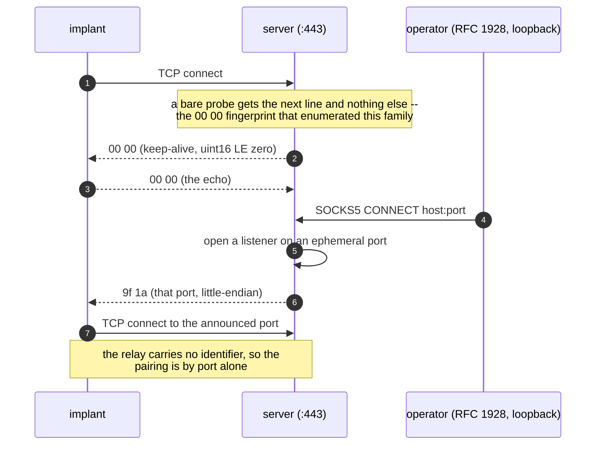
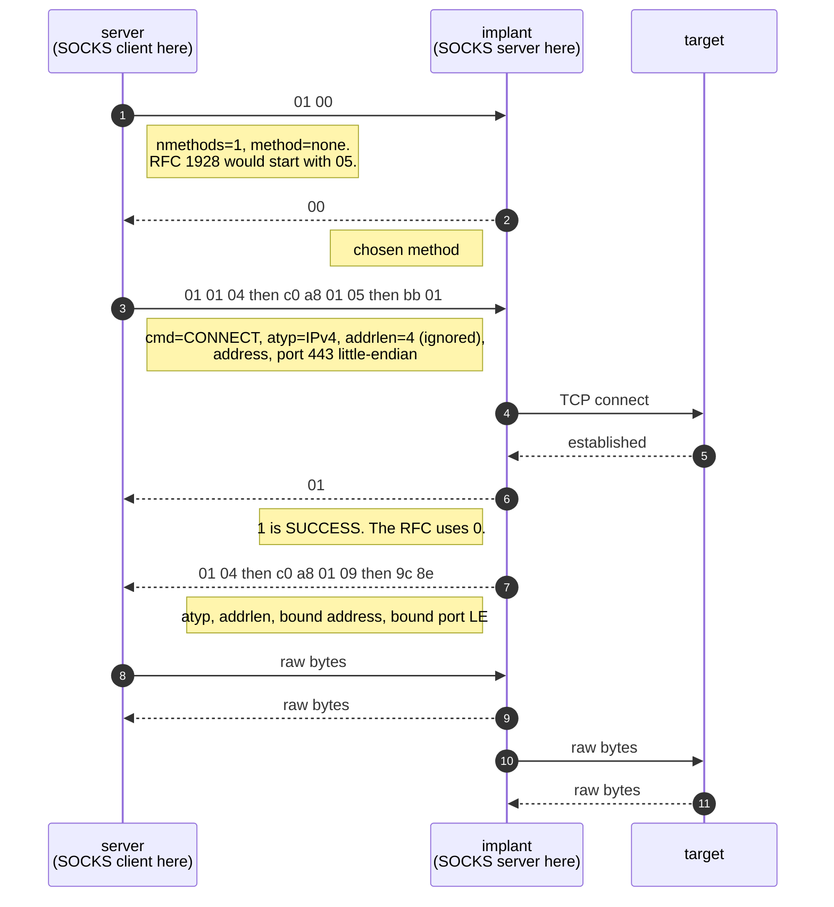
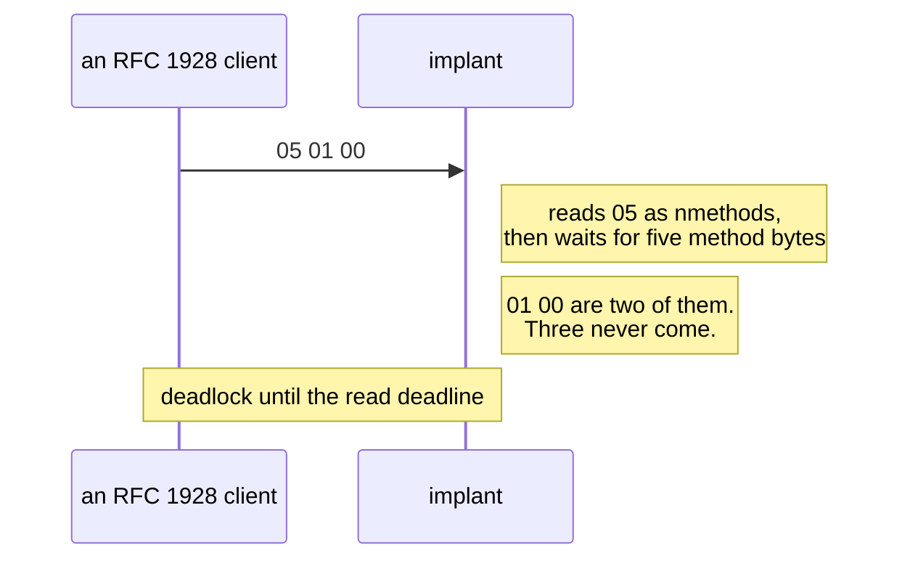

# The wire

SOCKS5 with pieces removed. Not a variant of RFC 1928 — a dialect that
confuses anything expecting the real thing.

The published client is the only description of this protocol that exists;
the server side was never published. Everything below was derived by reading
it, and `server/server.py` is written to the same derivation. Where the two
disagree the client is right: it is the artefact that was observed.

## In one table

| Step | Bytes | How it differs from RFC 1928 |
|---|---|---|
| Command channel | server → client `uint16` **little-endian** port; `0` is a keep-alive, answered with a `0` | not in the RFC at all |
| Greeting | `nmethods \| methods` | **no version byte** |
| Method select | one byte: `0` none, `2` user/pass, `255` unacceptable | — |
| Auth | `ulen \| plen \| uname \| passwd` | RFC 1929 interleaves them as `VER ULEN UNAME PLEN PASSWD` |
| Auth reply | `1` ok, `0` fail | **inverted** |
| Request | `cmd \| atyp \| addrlen \| addr \| port(2, LE)` | no version, no RSV, `addrlen` present even for IPv4 where it is ignored, port **little-endian** |
| Reply | `status(1)`, then `atyp(1)=1 \| addrlen(1)=4 \| addr(4) \| port(2, LE)` | `1` = success |
| Then | raw bidirectional relay | — |

No BIND, no UDP ASSOCIATE, no IPv6 — all three refused, as in the original.

## The command channel

One connection, held open, carrying `uint16` port numbers and nothing else.

Two structural properties follow, and both are reproduced rather than fixed:

- **A relay connection carries no identity.** The client simply dials the
  port it was told, so the server opens one listener per pending session and
  pairs by port. That is why a scan of a real C2 of this family shows a
  spread of five-digit ports — and why whoever reached the port first could
  take the session.
- **The command port answers a bare probe with `00 00`.** That is the
  keep-alive leaking to anyone who connects, and it is the fingerprint by
  which researchers enumerated this infrastructure across hosting providers.
  Removing it would mean measuring something that is not this family.

## The relay handshake

On the relay connection the roles invert: the **server** is the SOCKS client
and the **implant** is the SOCKS server. That inversion is the whole idea of
a reverse tunnel.

## What an RFC client does instead

A consequence worth knowing if you compare notes with other emulations: a
**public simulation of this family sends `05 01 00`**, the RFC 1928 greeting.
The real client reads the first byte as `nmethods`, so `05` makes it wait for
five method bytes that never come.

An RFC greeting does not talk to this family, which is exactly what the "no
version byte" row in the table means in practice.

## What the two sides refuse

| Asked for | Implant answers | Server turns that into |
|---|---|---|
| BIND or UDP ASSOCIATE | `00` | RFC `07`, command not supported |
| IPv6 target | `00` | refused before it is sent; the server will not forward an `atyp` the client has no code for |
| an unreachable target | `00` | RFC `05`, connection refused |
| a target that connects | `01` + bound address | RFC `00` + bound address |

The server translates in both directions, because the dialect has no version
bytes, little-endian ports and inverted status codes. Every difference is a
deviation the original introduced and the server has to undo.
